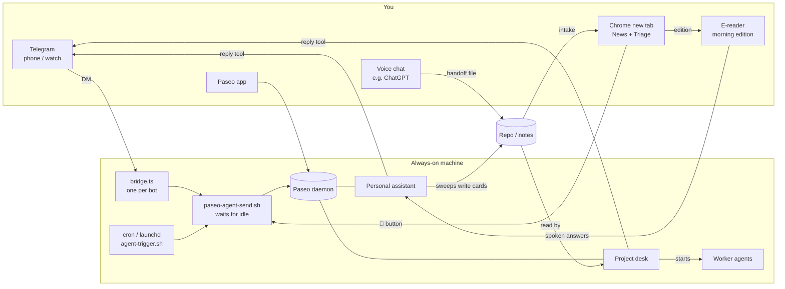

# How the pieces fit

Three layers, each useful on its own:

1. **Always-on agents** ([`../agents/`](../agents/)). A personal assistant and
   one "desk" per project run as long-lived sessions in Paseo on a machine that
   stays on. They keep their context between conversations and anything can
   message them.
2. **Ways in** ([`../bridge/`](../bridge/), [`voice-handoff.md`](voice-handoff.md)).
   You reach them from Telegram on your phone or watch, from the Paseo app, or
   by dropping a handoff in a repo after a voice conversation. Scripts and
   buttons reach them through the same idle-safe send.
3. **A front page** ([`../front-page/`](../front-page/)). Your new tab is a
   ranked feed of your sources, rebuilt twice a day. Two buttons on every story
   (📖 to your e-reader, 💬 to your assistant), a Triage tab with the day's open
   items, and a morning edition on the e-reader that you answer by voice.



## A day with it

```
06:00  the new tab rebuilds from your sources and ranks them against your profile
06:12  the assistant's morning sweep writes the day's intake cards
06:40  the morning edition goes to the e-reader
07:00  coffee, e-reader, voice recorder: "headline 7, follow up", "T3, drop"
       the assistant works through the answers before you open a laptop
day    new tab: 💬 on a story ("is our project affected by this?") starts the
       assistant on it; 📖 sends a long read to the e-reader
       Telegram: text the project desk from anywhere; it answers, or starts a
       worker and tells you when it's done
       a walk: talk a plan through by voice, end with "write the handoff";
       the desk picks it up
12:33  midday sweep (speaks only for same-day urgent items)
17:03  close sweep
18:00  the new tab rebuilds
```

## Choosing what to adopt

| If you want | Start with |
|---|---|
| To text your coding agent from your phone | `bridge/` + one desk from `agents/` |
| A feed of your own sources instead of social media | `front-page/extension/` alone (it needs only an API key) |
| A morning reading and voice-answer habit | `front-page/` end to end, with an assistant from `agents/` |
| To plan away from the screen | `docs/voice-handoff.md` + any agent that reads the repo |

## Requirements at a glance

- macOS or Linux machine that stays on, with [Paseo](https://github.com/getpaseo/paseo),
  [Bun](https://bun.sh), Python 3, and the agent CLI you use (Claude Code,
  Codex, ...). The launchd parts are macOS; on Linux use systemd user services.
- A Telegram bot per agent you want to text (free, from @BotFather).
- For the front page: Chrome, Node 20+, pnpm, an Anthropic API key, and an
  e-reader route (Readwise Reader on an iPad, or a Kobo with the included
  Wallabag-compatible server).
